<h1 align="center">
  
</h1>

A Claude skill that makes written text specific, useful and human-edited instead of generic "AI slop". It works on English and Indonesian text, in two modes:

- **Write mode:** Claude drafts with the principles applied, then self-checks before delivering.
- **Audit / rewrite mode:** you paste a draft, Claude reports what is actually wrong, then rewrites it.

The skill treats slop as a quality problem, not an authorship verdict. It never claims a text "was written by AI" and it does not try to beat AI detectors. It judges substance, specificity and usefulness, in that order: facts first, then wording, then structure, then formatting.

## Two ways to use it

1. **The Claude skill.** Claude writes and audits with the principles applied. See [Install](#install).
2. **The web scanner.** Open `index.html` (or the GitHub Pages site) and paste a draft. Matching spans are marked in place, with the numbers and a short list of what to read twice. It runs in your browser, nothing is uploaded, and the page works in Indonesian and English.

The web scanner is a port of `scan_text.py` with the same phrase lists and thresholds. `test/parity.js` checks that both give identical numbers on the same text.

### What the web scanner marks

| | Mark | What to check |
|---|---|---|
|  | Stock phrase | Keep it only if it carries meaning in this sentence. |
|  | Contrast framing ("not just X but Y") | Does it repeat as a template across the text? |
|  | Placeholder or meta text | Leftovers such as `[Insert name here]`. Remove them. |
|  | Connector opener ("Moreover", "Selain itu") | Is the logical link real, or is it filler? |
|  | Closing heading ("Conclusion", "Kesimpulan") | Does it add more than a recap? |

### Slop meter

The page also shows a 0 to 100 gauge built from the scan, for a quick read. It is a signal level, not the chance that an AI wrote the text.

| Part | Points |
|---|---|
| Stock phrase density | 1.2 per phrase per 1000 words, up to 60 |
| Contrast framing | 10 each, up to 20 |
| Leftover placeholders | 15 if any |
| Closing heading | 5 if any |
| Connector openers | 3 each, up to 12 |

Under 25 is low, under 55 is medium, the rest is high. Texts under 120 words are marked as short, because densities are unreliable there. A text that lists slop on purpose scores high too: `references/patterns.md` in this repo gets 95, `SKILL.md` gets 7. The gauge exists only in the web version, `scan_text.py` prints the raw numbers. `node test/meter.js` pins the behaviour.

## What is in the box

```
index.html                        # web scanner: paste text, marked spans, slop meter, EN/ID
scanner.js                        # scanner engine + meter, browser and Node, no dependencies
assets/
├── banner.svg                    # animated before/after banner used at the top of this README
├── logo.svg                      # logo, also the favicon of the web page
└── icon-*.svg                    # one icon per kind of mark (phrase, contrast, placeholder, connector, closing)
test/
├── parity.js                     # checks scanner.js against scan_text.py
└── meter.js                      # pins the slop meter behaviour
anti-ai-slop-text/                # the Claude skill (upload this folder)
├── SKILL.md                      # entry point: modes, writing principles, audit workflow
├── references/
│   ├── patterns.md               # catalog of slop patterns (ID + EN) with fixes
│   ├── rewrite-examples.md       # before/after pairs: blurb, announcement, README, email...
│   └── audit-checklist.md        # 12-indicator checklist, scoring, false-positive list
└── scripts/
    └── scan_text.py              # heuristic scanner, Python 3, no dependencies
examples/
├── sample-slop.txt               # deliberately bad text to try the scanner on
└── tesla-slop.txt                # one paragraph of typical slop about Nikola Tesla
```

## Run the web scanner

No build step. Either open `index.html` directly, or serve the folder:

```bash
python3 -m http.server 8000   # then open http://localhost:8000
```

To publish it, enable GitHub Pages for this repo: Settings, Pages, Source "Deploy from a branch", branch `main`, folder `/ (root)`.

Checks, both need Node 14 or newer and nothing else:

```bash
node test/parity.js    # scanner.js gives the same numbers as scan_text.py
node test/meter.js     # the meter lands high on slop, low on plain text
```

## Install

**Claude Code.** Copy the skill folder into your skills directory:

```bash
# for all your projects
cp -r anti-ai-slop-text ~/.claude/skills/

# or for one project only
cp -r anti-ai-slop-text /path/to/your/project/.claude/skills/
```

**Claude (web / desktop app).** Zip the inner `anti-ai-slop-text/` folder (the one that contains `SKILL.md`, not the repo root) and upload it through the Skills section of Claude's settings.

## Use

Once installed, Claude picks the skill up by itself when it writes or edits prose, so you do not have to mention it. You can also ask directly:

- `/anti-ai-slop-text` followed by a draft, to audit and rewrite it
- "does this sound like AI?" with a pasted text
- "tighten this README" or "bersihin pengumuman ini"

If you only want an audit, say so. Claude then reports findings and offers the rewrite instead of rewriting unasked.

## The scanner

`scan_text.py` is a pointer, not a judge. It highlights spans worth reading and prints rough densities: stock phrases, em dashes, bold and heading density, "not just X but Y" framing, sentence rhythm, leftover placeholders. It never estimates whether a human or a model wrote the text.

```bash
python3 anti-ai-slop-text/scripts/scan_text.py examples/sample-slop.txt
python3 anti-ai-slop-text/scripts/scan_text.py draft.txt --json
cat draft.txt | python3 anti-ai-slop-text/scripts/scan_text.py -
```

Output on the bundled sample (259 words):

```
words: 259   sentences: 18   paragraphs: 7
stock phrase hits: 42 (162.2/1000w)   connector openers: 6   contrast framing: 3
placeholders / meta text:
  - [Insert your company name here]
closing headings: ## Conclusion
```

A single hit means little. Clusters of hits in text that also says nothing are the signal.

## What the skill will and will not do

It will:

- cut sentences that carry no information, before rephrasing anything
- keep names, numbers, quotes, code and legal wording exactly as written
- keep the language and register: Indonesian stays Indonesian, casual stays casual
- ask you for missing facts instead of inventing them

It will not:

- swap "many users" for "73% of users" unless you gave that number
- run a blanket find-and-replace on em dashes or any other single token
- flatten your voice into neutral beige
- promise that a text passes an AI detector

## Contributing

New patterns, better Indonesian examples and false-positive reports are the most useful contributions. See [CONTRIBUTING.md](CONTRIBUTING.md).

## License

MIT. See [LICENSE](LICENSE).
